## Hakkımızda

Her yazılım bir ihtiyaçla başlar. Zamanla o ihtiyacın etrafında yeni ekranlar, ayarlar ve özellikler birikir. Çoğu zaman da asıl soru gözden kaçar: Bu yazılım hangi işi çözmek için var?

KAREM Yazılım'da her işe bu soruyla başlıyoruz. İzmir'den, işin özüne odaklanan yazılımlar geliştiriyoruz. Önce problemi anlıyor, sonra ona gerçekten gereken çözümü kuruyoruz. Fazlasını değil, doğrusunu yapmayı hedefliyoruz.

## Ürünler

### [Yurt](https://github.com/karemyazilim/yurt)

Kendi sunucunuzda barındırabileceğiniz, açık kaynak bir PaaS platformu. Dokploy tabanlı olan Yurt; Türkçe arayüzü, uygulanmış güvenlik yamaları ve Netgsm SMS bildirimleriyle Vercel, Heroku ve Netlify'a Türkçe bir alternatif sunar.

## Teknoloji Yığını

**Diller ve çalışma ortamı**

**Web**

**Veri**

**Altyapı ve araçlar**

## İletişim

---

KAREM Yazılım · İzmir
